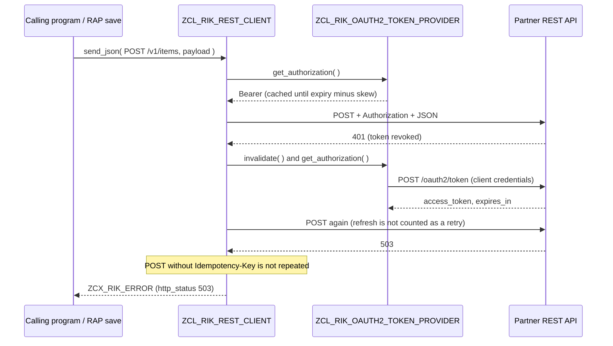

# abap-rest-integration-kit

**Reusable building blocks for SAP ↔ REST integrations in ABAP: an OAuth 2.0 token provider with caching, a REST client that retries safely, JSON helpers, a consolidated S/F response builder and an inbound HTTP handler. Everything above the network call is unit-tested with test doubles.**


Written from scratch as a generalised version of the patterns I use for SAP ↔ CRM (Salesforce-style) REST integrations. No client objects, endpoints or field names.

## What is in the kit

| Object | Role |
|---|---|
| `ZIF_RIK_HTTP_TRANSPORT` / `ZCL_RIK_HTTP_TRANSPORT` | The only code that touches the network, on the released web HTTP client (`cl_web_http_client_manager`). Returns HTTP errors as data and raises only for connection problems, flagged `transient` |
| `ZIF_RIK_TOKEN_PROVIDER` / `ZCL_RIK_OAUTH2_TOKEN_PROVIDER` | OAuth 2.0 client-credentials flow, URL-encoded form body, token cached until shortly before `expires_in` (configurable skew), `invalidate( )` after a 401 |
| `ZCL_RIK_REST_CLIENT` | Adds `Authorization` and `Accept`, refreshes the token **once** on 401, retries 429 / 502 / 503 / 504 and connection errors with exponential back-off, honours `Retry-After` (capped), **never repeats a POST/PATCH** unless the server rejected it (429) or the caller sent an `Idempotency-Key` |
| `ZCL_RIK_JSON` | One place for the naming convention (`camelCase` by default) on top of `/ui2/cl_json` |
| `ZCL_RIK_RESPONSE_BUILDER` | Consolidated **S/F** response: one result per inbound record, **all** validation messages of a record together, overall `S` only when every record succeeded, HTTP 200 / 422 |
| `ZIF_RIK_INBOUND_PROCESSOR` / `ZCL_RIK_INBOUND_HANDLER` | HTTP service handler (`if_http_service_extension`): POST only, JSON in, consolidated response out, HTTP 400 for unreadable payloads |
| `ZCL_RIK_DEMO_ITEM_PROCESSOR` | Example processor that validates an `items` array field by field |
| `ZIF_RIK_CLOCK` / `ZCL_RIK_SYSTEM_CLOCK` | Injected time source so expiry and back-off are testable without waiting |
| `ZCX_RIK_ERROR` | Carries `http_status`, `transient` and the response body |

## Outbound flow



## Inbound response contract

```json
{
  "status": "F",
  "message": "1 of 2 record(s) failed",
  "total": 2,
  "succeeded": 1,
  "failed": 1,
  "records": [
    { "reference": "EXT-1", "status": "S", "sapKey": "1000/M-100", "messages": [ { "field": "", "text": "Validated" } ] },
    { "reference": "EXT-2", "status": "F", "sapKey": "",
      "messages": [ { "field": "material", "text": "Material is required" },
                    { "field": "quantity", "text": "Quantity must be greater than zero" } ] }
  ]
}
```

The partner gets every problem with a record in one round trip instead of fixing errors one at a time, and can match results by its own `reference`.

## Usage

```abap
DATA(tokens) = NEW zcl_rik_oauth2_token_provider(
                 config = VALUE #( token_url     = `https://login.example.com/oauth2/token`
                                   client_id     = client_id
                                   client_secret = client_secret ) ).

DATA(client) = NEW zcl_rik_rest_client( base_url       = `https://api.example.com`
                                        token_provider = tokens ).

TRY.
    DATA(response) = client->send_json(
      method  = `POST`
      path    = `/v1/items`
      payload = item
      headers = VALUE #( ( name = zcl_rik_rest_client=>c_idempotency_header value = item-reference ) ) ).

    zcl_rik_json=>from_json( EXPORTING json = response-body CHANGING data = result ).
  CATCH zcx_rik_error INTO DATA(error).
    " error->http_status, error->transient, error->response_body
ENDTRY.
```

## Design notes

**Secrets.** For productive systems keep credentials out of code and tables: use a communication arrangement or destination with OAuth 2.0 client credentials, so the platform stores the secret and handles tokens. `ZCL_RIK_HTTP_TRANSPORT` builds the destination from a URL to keep the kit self-contained; switch it to `cl_http_destination_provider=>create_by_comm_arrangement` (ABAP Cloud) or an SM59 destination (on-premise) in a real landscape.

**Retries and the LUW.** The default clock waits with `WAIT UP TO`, which triggers a database commit. Do not call the client with retries inside an open RAP save sequence or an update task; queue the call (bgPF, application job) and let that process retry.

**Why idempotency matters.** A 503 or a dropped connection after a POST does not tell you whether the partner created the record. Repeating it can create a duplicate customer, booking or payment. The client therefore repeats POST/PATCH only for 429 (rejected before processing) or when an `Idempotency-Key` lets the server de-duplicate.

**Testability.** Transport, token provider and clock are interfaces, so the ABAP Unit tests cover token caching and renewal, form encoding, 401 refresh, retry and back-off rules, `Retry-After` capping and the consolidated response without any network or waiting.

## Installation

1. Create package `ZRIK` and pull this repository with abapGit (folder logic PREFIX, starting folder `/src/`).
2. For inbound use, create an HTTP service in ADT with handler class `ZCL_RIK_INBOUND_HANDLER` and replace the demo processor with your own `ZIF_RIK_INBOUND_PROCESSOR` implementation.
3. Run the unit tests: select the package in ADT, *Run As > ABAP Unit Test*.

Target: BTP ABAP Environment or S/4HANA 2021 and later (released web HTTP client). Authored against those APIs but not activated from this repository's CI; please pull into a sandbox first and open an issue if an object does not activate on your release.

## License

MIT, see [LICENSE](LICENSE). Original demo code; no customer or employer objects.
